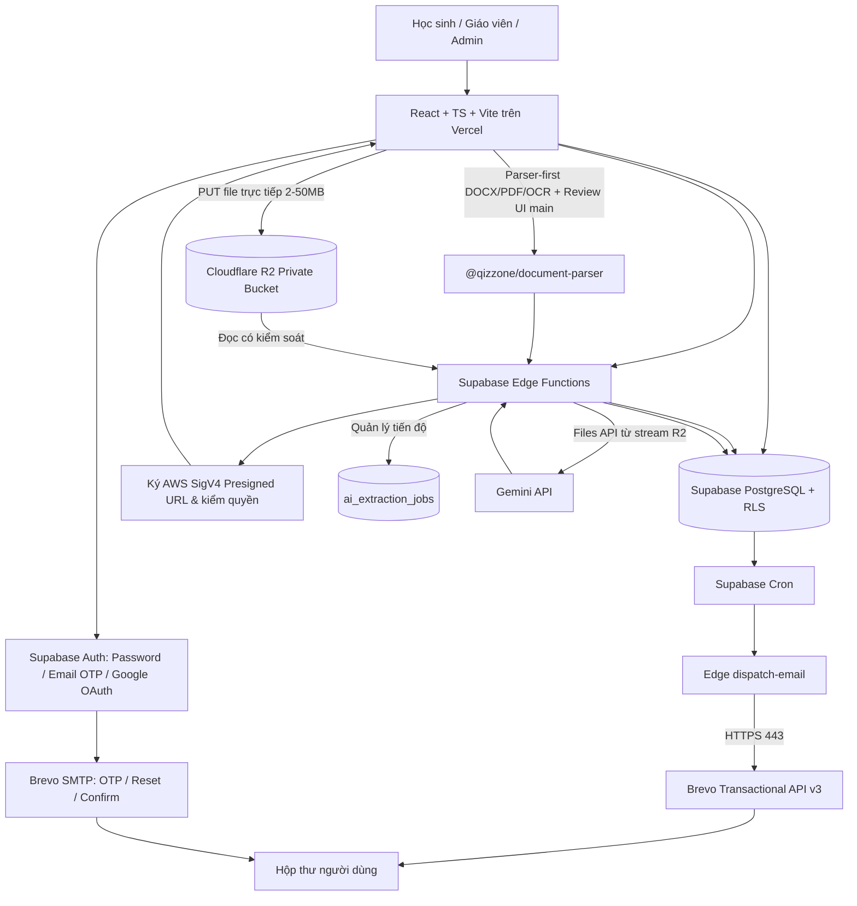

# QIZZONE V3 — KIẾN TRÚC HỆ THỐNG (ARCHITECTURE_V3)

> **Nhánh triển khai:** `fix/devolopV3`
> **Nguồn chuẩn UI & Nghiệp vụ:** `main` (`42830769097c85638cc2f2e8413df4e37e215aa4`)
> **Nguồn chuẩn Module Extraction:** `devolop/AIV3` (`3c5199581f72046e2595d865be18cc9567785657`)

---

## 1. Tổng quan Kiến trúc Đích

Qizzone V3 tách bạch hoàn toàn khỏi Firebase, Northflank và ASP.NET Core; vận hành 100% trên stack:
- **Frontend SPA:** React 19 + TypeScript strict + Vite 8 + Tailwind v4 triển khai trên **Vercel** (`apps/web/`).
- **Shared Packages:** `@qizzone/domain` (`packages/domain/`) và `@qizzone/document-parser` (`packages/document-parser/`).
- **Identity, Database & API Gateway:** **Supabase** (Supabase Auth + PostgreSQL + Row Level Security + Edge Functions + Cron).
- **Private Object Storage:** **Cloudflare R2** (bucket private, browser upload trực tiếp qua Presigned PUT URL ngắn hạn).
- **AI Extraction Fallback:** **Gemini API** (`gemini-3.8-flash`, fallback `gemini-3.5-flash-lite`) kết hợp **Gemini Files API** cho tệp scan/lớn từ R2.
- **Email Auth & Transactional:** **Brevo** (Brevo SMTP `smtp-relay.brevo.com:587` cho Supabase Auth OTP/Confirm/Reset; Brevo HTTPS REST API v3 `POST https://api.brevo.com/v3/smtp/email` qua `dispatch-email` + `notification_outbox` cho thông báo nghiệp vụ, Free tier 300 email/ngày).

---

## 2. Ranh giới Thành phần & Bất biến Bảo mật

1. **Vercel (`apps/web`):** Host tĩnh, không giữ secret; chỉ nhận `VITE_SUPABASE_URL` và `VITE_SUPABASE_PUBLISHABLE_KEY`. Cấu hình `X-Frame-Options: DENY`, `X-Content-Type-Options: nosniff`, immutable caching cho `/assets/*`.
2. **Supabase Auth & Phân quyền:**
   - Mọi đăng ký mới mặc định bắt đầu ở vai trò `student`.
   - Nâng cấp lên `teacher` đi qua luồng `request-teacher-role` → `manage-teacher-approvals` (chỉ `admin` đã duyệt) → `switch-account-role`.
   - Quyền hiệu lực được đọc từ `profiles` / `user_roles` và `app_metadata.app_role` (do `service_role` cập nhật), **không bao giờ đọc `user_metadata` do client sửa**.
3. **Supabase PostgreSQL & RLS:**
   - Bật RLS mặc định cho mọi bảng public.
   - Đáp án đúng lưu tại `question_answer_keys` và `private.answer_keys`; không có policy `SELECT` cho học sinh.
   - Chấm điểm bài thi (`submit_attempt`, `finalize_exam_attempt`) và luyện tập (`check_practice_answer`, `finish_practice`) thực hiện hoàn toàn ở server-side trong `SECURITY DEFINER` RPC với `search_path = ''`.
4. **Supabase Edge Functions (Giới hạn tài liệu chính thức Free Tier):**
   - Active CPU tối đa **2 giây/request**, RAM **256 MB**, wall-clock **150 giây**, **cổng SMTP 25 và 587 bị chặn** (phải gửi mail qua Brevo HTTPS API v3 port 443).
   - Vì vậy: mọi tác vụ CPU-heavy (parse OpenXML AST, PDF.js text/highlight/red-text, OCR Tesseract `vie+eng` tối đa 10 trang/lượt) chạy tại trình duyệt; file lớn tải thẳng lên R2 không đi qua body 8 MiB của Edge; Edge `extract-quiz` stream object từ R2 sang Gemini Files API và lưu trạng thái durable trong `ai_extraction_jobs`.
5. **Cloudflare R2:**
   - Bucket private; browser upload bằng Presigned PUT URL (TTL 60–300 giây, scoped key `materials/<uid>/<materialId>-<safeName>`).
   - CORS chỉ cho phép domain staging/production hợp lệ (`PUT`, `HEAD`).
6. **Gemini API & Files API (`ai.google.dev`):**
   - Model cấu hình mặc định: `gemini-3.8-flash`, fallback `gemini-3.5-flash-lite` (đối chiếu tài liệu 2026: `gemini-2.5-flash` ngừng hoạt động/auto-route từ 01/12/2026).
   - Files API hỗ trợ tối đa 2 GB/file, 20 GB/project, lưu tạm 48 giờ; Edge chủ động gọi `DELETE` file trên Gemini ngay sau khi trích xuất xong.
   - Kết quả từ AI bắt buộc đi qua `parseGroundedAIResult` và `mergeExtractionResults` trong `@qizzone/document-parser`, giữ `correctAnswers` rỗng nếu thiếu chứng cứ nguồn và luôn ở trạng thái `reviewStatus = "pending"` trên UI `main` cho đến khi giáo viên xác nhận.
7. **Brevo SMTP & API v3:**
   - SMTP tùy chỉnh trên Supabase Auth để gửi OTP có thương hiệu Qizzone (tuân thủ chính sách giới hạn template Free mặc định của Supabase từ 03/06/2026).
   - Transactional emails qua `notification_outbox` + `dispatch-email` với atomic `processing` claim, `idempotency_key`, múi giờ `Asia/Ho_Chi_Minh`, giới hạn trần ngày Free tier (`300` email/ngày), exponential backoff và dead-letter.
