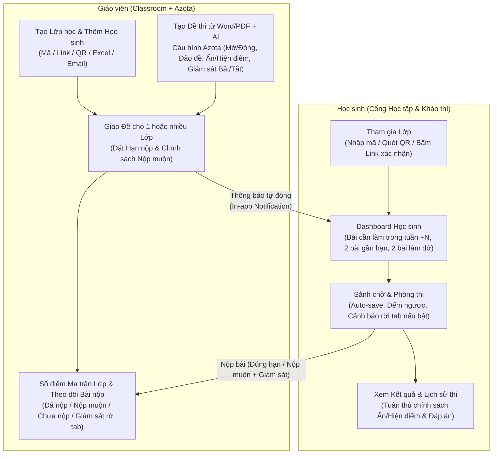

# ĐẶC TẢ NGHIỆP VỤ HỆ THỐNG QIZZONE V3
**Mô hình:** *Google Classroom (Quản lý Lớp & Bài tập) × Azota (Số hóa Đề thi AI & Khảo thí Trực tuyến)*

---

## 1. Tổng quan & Định vị Hệ thống

Qizzone V3 là nền tảng giáo dục trực tuyến kết hợp sức mạnh **quản lý lớp học có tổ chức của Google Classroom** với **quy trình số hóa đề thi, cấu hình khảo thí và giám sát phòng thi của Azota**.

| Thành phần | Học hỏi từ **Google Classroom** | Học hỏi từ **Azota** | Điểm nâng cấp của **Qizzone V3** |
| :--- | :--- | :--- | :--- |
| **Quản lý lớp học** | Tổ chức lớp theo môn/khối, tham gia bằng Mã lớp / Link mời / QR / Import Excel danh sách học sinh | Giao đề trực tiếp vào lớp hoặc mở tự do qua mã phòng 6 ký tự | Kết hợp cả **Học tập theo lớp (LMS)** và **Thi tự do ngoài lớp (Quick Room Code)** trên cùng một cổng |
| **Tạo & Số hóa đề** | — | Tải file `.docx`, `.pdf`; tách câu hỏi, công thức Toán ($\LaTeX$), hình vẽ tự động | Bộ parser lai **Rule-based AST + PDF Vector/Image + Gemini AI** tự động giải đáp án khuyết & sinh lời giải |
| **Cấu hình thi** | Giao bài có `Ngày mở`, `Hạn nộp (Due Date)`, chính sách `Nộp muộn` | Đảo câu/đáp án, giới hạn số lượt làm, cài đặt ẩn/hiện điểm & đáp án theo thời điểm | Tách biệt rõ **Chính sách Đề thi (Quiz Settings)** và **Chính sách Giao bài theo từng Lớp (Classroom Assignment)** |
| **Phòng thi & Ôn tập** | Theo dõi trạng thái `Cần làm` / `Đã hoàn thành` / `Quá hạn` / `Nộp muộn` | Tự động lưu nháp (auto-save), tự nộp khi hết giờ, **giám sát chuyển tab / rời màn hình (bật/tắt theo đề, mặc định tắt)** | Có thêm **Chế độ Luyện tập (Practice Mode)** kiểm tra từng câu độc lập, khóa lộ đáp án hàng loạt |
| **Sổ điểm & Báo cáo** | Sổ điểm ma trận toàn lớp theo từng bài tập | Thống kê phổ điểm, tỷ lệ đúng/sai từng câu, xuất Excel | Tích hợp **Sổ điểm Ma trận theo lớp (Gradebook)** + **Theo dõi tiến độ nộp bài** + **Báo cáo giám sát phòng thi** |

---

## 2. Phân quyền & Tác nhân (Actors & RBAC)

Hệ thống vận hành với **3 vai trò chính** (được kiểm soát chặt ở tầng Database RLS & RPC):

1. **Quản trị viên (Admin):**
   - Phê duyệt / từ chối yêu cầu nâng cấp tài khoản Giáo viên (kèm thông báo tự động).
   - Quản lý toàn bộ tài khoản (Giáo viên / Học sinh): Xem hồ sơ chi tiết (số lớp, số đề, số lượt nộp), khóa/mở khóa tài khoản, chuyển đổi vai trò.
   - Tiếp nhận, phân loại (Severity/Status) và phản hồi **Báo cáo lỗi (Bug Reports)** từ người dùng.
2. **Giáo viên (Teacher):**
   - Tạo và quản lý nhiều lớp học; thêm học sinh qua Email, file Excel (`.xlsx`/`.csv`), Mã lớp, Link mời hoặc Mã QR.
   - Soạn đề thủ công hoặc tải file Word/PDF để bóc tách tự động; dùng AI điền đáp án khuyết.
   - Cấu hình thông số khảo thí kiểu Azota (bao gồm tùy chọn **Giám sát chống gian lận**, mặc định tắt) và giao đề cho một hoặc nhiều lớp cùng lúc.
   - Theo dõi tiến độ nộp bài theo từng lớp (`Đã nộp`, `Chưa nộp`, `Nộp muộn`), xem **Sổ điểm ma trận toàn lớp**, thống kê phổ điểm và phân tích câu hỏi.
3. **Học sinh (Student):**
   - Tham gia lớp qua **Mã lớp**, **Quét mã QR** (camera hoặc tải ảnh QR), **Link mời xác nhận**, hoặc được giáo viên thêm sẵn qua email.
   - Quản lý tiến độ trên Dashboard cá nhân: Số bài cần làm trong tuần (kèm chỉ số tăng trưởng bài mới `+N`), số lớp đã tham gia, số bài làm ngoài lớp, 2 bài gần hạn nhất, 2 bài đang làm dở và lịch sử thi phân trang (10 bài/trang).
   - Làm bài thi chính thức (đồng bộ phiên làm bài thời gian thực) hoặc tự ôn qua Chế độ Luyện tập.

---

## 3. Đặc tả Nghiệp vụ Chi tiết theo 6 Phân hệ

### Phân hệ 1: Quản lý Lớp học chuẩn Google Classroom (`Classroom Management`)

1. **Khởi tạo & Cài đặt Lớp học:**
   - Giáo viên tạo lớp với: `Tên lớp`, `Môn học`, `Khối lớp`, `Mô tả`.
   - Hệ thống tự sinh `Mã mời (Invite Code)` duy nhất. Giáo viên có thể **Bật / Tắt mã mời**, **Đổi mã mời mới**, hoặc **Lưu trữ lớp (Archive)** khi kết thúc học kỳ.
2. **4 Cơ chế Tham gia Lớp học:**
   - **Cách 1 — Nhập mã lớp:** Học sinh mở popup `Tham gia lớp` → tab `Nhập mã` (chấp nhận cả mã ngắn hoặc dán nguyên đường dẫn).
   - **Cách 2 — Quét mã QR:** Học sinh chuyển sang tab `Quét mã QR` → quét trực tiếp qua Camera hoặc tải ảnh QR do giáo viên chia sẻ.
   - **Cách 3 — Đường dẫn mời (`/class/join/:code`):** Khi bấm link, hệ thống mở **Trang xác nhận thông tin link lớp** (hiển thị mã lớp, đường dẫn, trạng thái thành viên) và nút **`Tham gia lớp`**. Nếu chưa đăng nhập, hệ thống giữ nguyên `redirect` để quay lại đúng trang xác nhận sau khi đăng nhập.
   - **Cách 4 — Giáo viên thêm danh sách (Roster Pre-enrollment):** Giáo viên nhập danh sách email hoặc tải file Excel. Nếu email chưa đăng ký tài khoản, hệ thống tạo bản ghi `invited_email` ở trạng thái chờ và **tự động kích hoạt vào lớp** ngay khi học sinh đăng ký/đăng nhập bằng email đó.
3. **Bảo mật Danh sách Lớp (Roster Privacy):**
   - Giáo viên thấy đầy đủ họ tên, email, phương thức tham gia và trạng thái của mọi học sinh.
   - Học sinh trong lớp chỉ thấy thông tin lớp và bài tập của mình, **tuyệt đối không lộ danh sách email cá nhân** của các học sinh khác.

---

### Phân hệ 2: Số hóa Đề thi & AI chuẩn Azota (`Exam Digitization`)

1. **Bóc tách Tài liệu Thông minh (Document Parser):**
   - Hỗ trợ tải lên file `.docx` và `.pdf`.
   - Tự động nhận diện cấu trúc câu hỏi, các phương án lựa chọn (`A–E`), công thức Toán học ($\LaTeX$ / MathML) và cắt hình ảnh/đồ thị vector đi kèm câu hỏi lên Cloudflare R2.
2. **Hỗ trợ AI (Gemini Integration):**
   - Với các câu hỏi chưa có đáp án trong file gốc, giáo viên nhấn **"Giải đáp án bằng AI"** để AI gợi ý đáp án đúng kèm lời giải chi tiết.
3. **Giao diện Kiểm duyệt Đề (Split Exam Editor):**
   - Màn hình chia đôi: Một bên là tài liệu gốc, một bên là danh sách câu hỏi đã bóc tách để giáo viên đối chiếu và duyệt xuất bản.

---

### Phân hệ 3: Cấu hình Phát hành & Giao bài (`Azota × Classroom Publishing`)

1. **Cấu hình Khảo thí trên Đề thi (Azota Exam Settings):**
   - **Phạm vi phát hành (`publishScope`):** `Công khai (Public)` hoặc `Chỉ lớp được giao (Class Only)`.
   - **Thời gian làm bài (`durationMinutes`)** & **Khung giờ mở/đóng đề (`opensAt` / `closesAt`)**.
   - **Số lượt làm bài tối đa (`maxAttempts`)**.
   - **Đảo câu hỏi (`shuffleQuestions`)** & **Đảo đáp án (`shuffleOptions`)**.
   - **Chính sách công bố Điểm (`scoreVisibility`) & Đáp án (`answerVisibility`):** `Ngay sau khi nộp`, `Sau khi đóng đề`, hoặc `Không hiển thị`.
   - **Giám sát chuyển tab / rời màn hình (`antiCheatEnabled`):** Có thể **bật hoặc tắt** theo từng đề thi, **mặc định TẮT (`false`)**.
2. **Cấu hình Giao bài cho Lớp (Classroom Assignment Settings):**
   - Giao 1 đề cho **nhiều lớp cùng lúc** với `Tiêu đề`, `Hướng dẫn`, `Ngày mở (availableFrom)`, `Hạn nộp (dueAt)`.
   - **Chính sách nộp muộn (`latePolicy`):** `Cho phép nộp muộn (allow_late)` (gắn nhãn `Nộp muộn`, có thể kèm `hardCloseAt`) hoặc `Chặn sau hạn (block_after_due)`.

---

### Phân hệ 4: Phòng thi, Giám sát Chống gian lận & Chế độ Luyện tập

1. **Sảnh chờ Phòng thi (`ExamEntry`):**
   - Kiểm tra điều kiện mở đề, hạn nộp, lượt làm bài, quyền truy cập lớp.
   - Nếu đề có bật `antiCheatEnabled`, hiển thị cảnh báo rõ ở sảnh chờ trước khi học sinh bấm bắt đầu làm bài.
2. **Phòng thi Chính thức (`QuizRoom`):**
   - **Không lộ đáp án ở Client:** API chỉ trả nội dung câu hỏi và phương án.
   - **Lưu nháp tự động (Auto-save)** và **Tự động thu bài** khi hết giờ.
   - **Giám sát Chống gian lận (khi `antiCheatEnabled = true`):**
     - Theo dõi sự kiện `visibilitychange` và `window.blur` (chống đếm trùng lặp).
     - Hiển thị hộp thoại cảnh báo ngay trên màn hình khi học sinh chuyển tab/thoát cửa sổ, đồng thời ghi nhận **`Số lần rời màn hình (tabSwitchCount)`** vào kết quả nộp bài.
3. **Chế độ Luyện tập (`PracticeRoom`):**
   - Ôn tập từng câu, xem giải thích ngay sau mỗi câu đã khóa, không ảnh hưởng dữ liệu điểm thi chính thức.

---

### Phân hệ 5: Theo dõi Nộp bài, Sổ điểm Ma trận & Phân tích

1. **Sổ điểm Ma trận theo Lớp (`ClassDetail → Tab Sổ điểm`):**
   - Bảng tổng hợp `Học sinh × Tất cả Bài tập trong lớp`, hiển thị tiến độ (`Đã nộp / Tổng bài`), điểm trung bình và xuất file CSV sổ điểm toàn lớp.
2. **Bảng Theo dõi Nộp bài & Phân tích Đề (`QuizResultsView`):**
   - Lọc theo lớp (`Đã nộp`, `Nộp muộn`, `Chưa nộp`), xem **cột Giám sát (`tabSwitchCount`)**, phân tích tỷ lệ đúng/sai từng câu hỏi và xuất bảng điểm CSV.

---

### Phân hệ 6: Thông báo Điều hướng & Báo lỗi Hệ thống

1. **Chuông Thông báo Trong ứng dụng (`NotificationBell`):**
   - Gửi thông báo tự động khi giao bài tập mới, duyệt/từ chối tài khoản giáo viên, hoặc cập nhật phiếu báo lỗi kèm liên kết điều hướng sâu (deep-link).
2. **Báo cáo & Xử lý Lỗi (`Bug Reports`):**
   - Người dùng gửi báo lỗi và theo dõi phản hồi trực tiếp từ Admin.

---

## 4. Sơ đồ Luồng Nghiệp vụ Tổng thể

