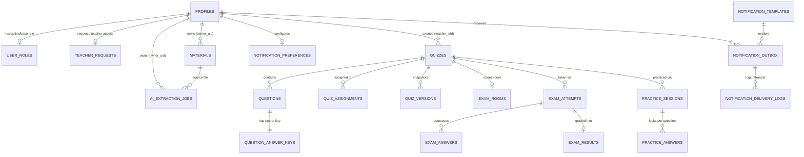

# QIZZONE V3 — THIẾT KẾ CƠ SỞ DỮ LIỆU & RLS (`DB_SCHEMA`)

> **Migrations:** [`supabase/migrations/`](file:///d:/Qizzone_ANTI/supabase/migrations)
> **Kiểm thử tự động:** PGlite RLS & Isolation suite tại [`databaseSecurity.integration.test.ts`](file:///d:/Qizzone_ANTI/apps/web/src/utils/__tests__/databaseSecurity.integration.test.ts) & [`practiceSecurity.integration.test.ts`](file:///d:/Qizzone_ANTI/apps/web/src/utils/__tests__/practiceSecurity.integration.test.ts).

---

## 1. Sơ đồ Quan hệ Thực thể (ERD)

---

## 2. Danh mục Bảng & Quyền Truy cập

### 2.1. Tài khoản, Phân quyền & Audit
| Bảng | Mục đích | Chính sách RLS |
|---|---|---|
| `public.profiles` | Hồ sơ người dùng (`id` UUID + `firebase_uid` text tương thích ngược), vai trò gốc, `approval_status`, `teacher_request_status` | Chỉ `authenticated` đọc hồ sơ của chính mình (`firebase_uid = current_uid()`) hoặc `admin`. Mọi thao tác đổi role từ client bị chặn. |
| `public.user_roles` | Lưu `base_role` & `active_role` do server quản trị | Chủ sở hữu hoặc `admin` chỉ có quyền `SELECT`; ghi thông qua `service_role`. |
| `public.teacher_requests` | Trạng thái yêu cầu nâng cấp giáo viên & cờ `blocked` | Chủ sở hữu hoặc `admin` chỉ có quyền `SELECT`. |
| `public.role_audit_logs` | Nhật ký phê duyệt/từ chối/chặn/chuyển vai trò | Chỉ `admin` đọc (`SELECT`). |
| `public.audit_logs` | Nhật ký thao tác nhạy cảm toàn hệ thống | Chỉ `service_role`. |

### 2.2. Đề thi, Đáp án Mật, Phòng thi & Luyện tập
| Bảng | Mục đích | Chính sách RLS |
|---|---|---|
| `public.quizzes` | Thông tin đề thi (`title`, `subject`, `code`, `status`, `settings`) | Đọc theo `can_read_quiz(id)` (chủ đề, admin, hoặc học sinh khi `published`). Ghi qua RPC `save_quiz`. |
| `public.questions` | Câu hỏi (`ordinal`, `content`, `images jsonb`, `type`, `options` 2–5 phương án `A..E`, `points`) | Đọc theo `can_read_quiz(quiz_id)`. |
| `public.question_answer_keys` & `private.answer_keys` | Đáp án đúng (`1..5` lựa chọn `A..E`) và lời giải | `question_answer_keys` chỉ cho chủ sở hữu đề/admin; `private.answer_keys` thu hồi toàn bộ quyền từ `anon`/`authenticated`. |
| `public.quiz_assignments`, `public.quiz_versions`, `public.exam_rooms` | Phân công lớp/email, snapshot phiên bản đề, phòng thi theo lịch | `exam_rooms` đọc qua `can_read_quiz(quiz_id)`; thao tác ghi qua RPC/server. |
| `public.exam_attempts`, `public.exam_answers`, `public.exam_results` | Phiên làm bài (optimistic concurrency `revision`), autosave đáp án, kết quả chấm | Student đọc `exam_attempts`/`exam_answers` của mình; đọc/nộp bài đi qua RPC (`start_attempt`, `save_attempt`, `submit_attempt`, `finalize_exam_attempt`). |
| `public.practice_sessions`, `public.practice_answers` | Phiên luyện tập tách biệt hoàn toàn với điểm thi | Chỉ đọc/ghi qua `start_practice`, `get_practice_session`, `check_practice_answer`, `finish_practice`, `start_practice_retry`. |
| `public.idempotency_keys` | Lưu kết quả phản hồi idempotent theo `(scope, actor_uid, idempotency_key)` | Chỉ `service_role` / `SECURITY DEFINER` RPC. |

### 2.3. Tài liệu R2 & AI Jobs
| Bảng | Mục đích | Chính sách RLS |
|---|---|---|
| `public.materials` | Metadata tệp trên Cloudflare R2 (`owner_uid`, `object_key`, `mime_type`, `size_bytes <= 50 MiB`, `sha256`, `status`, `expires_at`) | `SELECT`/`INSERT`/`UPDATE` kiểm tra `owner_uid = current_uid()` và role `teacher`/`admin` với cả `USING` và `WITH CHECK`. |
| `public.ai_extraction_jobs` | Trạng thái xử lý AI async (`queued\|processing\|completed\|failed`, `progress`, `warnings`, `result_draft`, `gemini_file_uri`) | Chỉ chủ job (`owner_uid = current_uid()`) hoặc `admin` được `SELECT`. |
| `public.ai_usage_daily` | Bộ đếm quota AI theo ngày (`Asia/Ho_Chi_Minh`) cho từng user | Chủ tài khoản hoặc `admin` được `SELECT`; tăng bộ đếm qua `consume_ai_quota_v3`. |

### 2.4. Email Notification & Outbox
| Bảng | Mục đích | Chính sách RLS |
|---|---|---|
| `public.notification_preferences` | Tùy chọn opt-in/opt-out từng loại email theo user | Chủ tài khoản có quyền `SELECT`/`INSERT`/`UPDATE` dòng của chính mình (`USING` + `WITH CHECK`). |
| `public.notification_templates` | Mẫu email HTML/Subject theo sự kiện | Chỉ `service_role` đọc/sửa. |
| `public.notification_outbox` | Hàng đợi gửi mail có `idempotency_key` duy nhất, `scheduled_at`, `status`, `attempt_count`, `next_attempt_at` | Chủ nhận hoặc `admin` được `SELECT`; ghi qua `enqueue_notification`. |
| `public.notification_delivery_logs` | Log chi tiết từng lần gửi qua Brevo (`provider`, `provider_message_id`, `status`, `delivered_at`) | Chỉ `service_role`. |

---

## 3. Chiến lược Backup, Restore & Rollback Migration

1. **Backup trước migration:** Thực hiện `supabase db dump --linked --schema public,private > backup_before_v3.sql` hoặc chụp Snapshot trên Supabase Dashboard trước khi áp dụng migration lên staging.
2. **Kiểm tra sạch (Local/CI):** Chạy `supabase db reset` (hoặc PGlite integration suite) để bảo đảm chuỗi migration chạy tuần tự từ file đầu đến `202611210001_v3_architecture_schema.sql` không lỗi.
3. **Rollback:** Các bảng V3 (`materials`, `ai_extraction_jobs`, `notification_*`, `user_roles`, `teacher_requests`) tách biệt hoàn toàn khỏi bảng lõi V1 (`quizzes`, `questions`, `exam_attempts`), nên có thể hạ migration mới bằng SQL rollback script hoặc khôi phục từ PITR/snapshot mà không làm mất dữ liệu thi hiện hữu.
